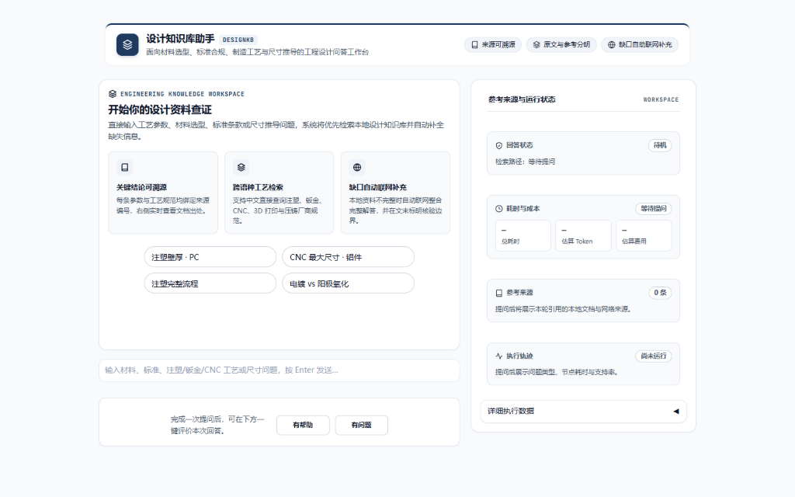
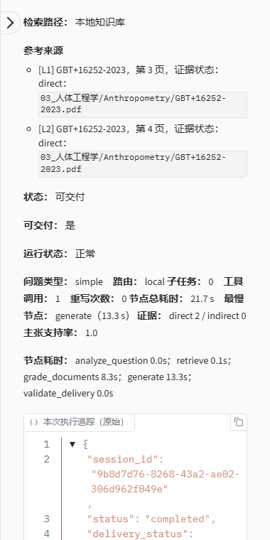
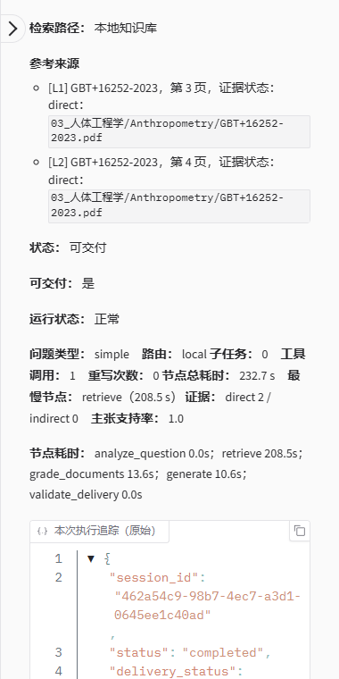
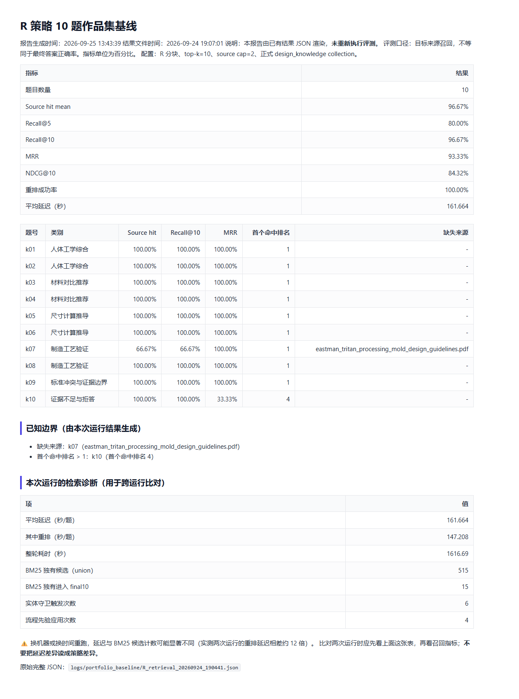

# 设计知识库助手 · DesignKB Agent

> 一个**可审计的 RAG 问答 Agent**：它不只回答问题，还回答「**这个答案的证据是什么、够不够、可不可信**」。
>   
> 本仓库同时是一次完整的产品实践记录——不只是代码，还有**产品决策、指标定义与失败处理**的全过程。

**给谁用**：做材料选型、标准合规、人体尺寸推导的设计师与设计学生。

**解决什么**：他们手上有一堆标准、TDS 和工艺指南，却**分不清引用的是原文、自己的记忆，还是模型编的**——
而这三件事在食品接触合规、材料牌号、尺寸依据上出错，代价不是「答案不好」，是返工。
本产品的做法是让每条实质结论都带证据等级，证据不足时**说「不足以回答」**。

**现在到哪一步了（不粉饰）**

| | 状态 |
| --- | --- |
| 能跑吗 | ✅ 本地可跑，3417 chunk 的设计知识库（见 §5）|
| 评测过吗 | ✅ 离线：R 策略 10 题检索基线 + 生成链路配对实验（见 §4）|
| 有真实用户吗 | ❌ **没有**——全部是自评与离线评测，5 人可用性测试是下一步 |
| 线上指标 / 反馈入口 | ❌ 没有 |
| 成本账（每问 token / GPU 秒）| ❌ 尚未计算 |

**三个关键决策**（完整推理与数据见 §3）

1. **超时后降级拒答，不放宽上限**——防的是「用户以为拿到了答案，其实模型在证据不足时硬编」
2. **拒绝「答案正确率」这类单值指标**——只报分层、带上下文的指标，并给口径升版
3. **调研完知识图谱后决定不做**——它的价值集中在复杂推理（+3~10pp），代价是 1~2 个数量级 token，
   而本项目的残余漏答在生成侧（[调研报告](reports/知识图谱增强RAG-开源项目调研报告.md)）

**文档导航**

| 想了解 | 看这里 |
| --- | --- |
| 产品文档：一页纸 PRD / RICE 优先级 | [docs/prd-feedback-loop.md](docs/prd-feedback-loop.md)、[docs/backlog-rice.md](docs/backlog-rice.md) |
| 产品决策与取舍的全过程 | §3 |
| 指标口径、判据、哪些结论不能得 | [docs/evaluation-contract.md](docs/evaluation-contract.md)、[docs/experiment-protocol.md](docs/experiment-protocol.md) |
| 评测链路结构与模块职责 | [docs/architecture.md](docs/architecture.md) |
| 怎么跑起来 | §5 |

---

## 1. 用户与场景

**目标用户**：做材料选型、标准合规、人体尺寸推导的设计师与设计学生。

**他们现在的替代做法**：翻 GB 标准 PDF、翻供应商 TDS、问同事、搜网页。

市面上的知识库问答 Demo 很多，共同问题是：**它给它看见的所有东西同等的信任**。
  
用户分不清哪句是资料原文、哪句是模型发挥、哪句根本是幻觉——
  
直到在标准合规、材料选型这类**错不起**的场景里出事。

这个产品的核心决策是：**把「证据状态」做成一等公民**。

- 每条主张标注 `direct`（直接证据）/ `indirect`（间接证据）——用户一眼看到答案有多硬
- 证据不足时**降级并说明原因**，不硬答（见 §3.1，这是本产品最重要的一个决定）
- 网络搜索结果标记为「需核验」，不混入正式依据

> ⚠️ 本节「目标用户 / 替代做法」是**产品假设，不是调研结论**——本项目还没有做过用户访谈或可用性测试，
> 验证计划在 [docs/prd-feedback-loop.md](docs/prd-feedback-loop.md) 第 9 节。

## 2. 产品架构（产品视角）

```
用户问题
  → 问题分析（判定简单/复杂）
  → 任务规划（复杂问题拆子任务并行检索）
  → 混合检索（BM25 + Dense + RRF → Cross-Encoder 重排）
  → 证据覆盖审计（主张 vs 证据，逐条判定）
  → [证据不足] → 网络补证（标记"需核验"）
  → 生成「带证据分级」的回答
```

领域无关：问题契约与任务图都是动态生成的，不针对任何具体产品写死流程。

## 3. 产品决策记录（本仓库最值得看的部分）

产品经理的工作不是把功能做出来，是**在信息和资源不全的时候做选择**。
  
以下是这个项目做过的 5 个真实决策，每个都有数据和推理链，可直接复现。

### 3.1 超时后选择「降级拒答」，而不是「放宽上限硬答」

**现象**：同一道题冷检索实测 208.5 秒可完成，但三次冷检索里有**两次撞上 300 秒上限**。
  
缓存命中时同一进程内再问只要 **0.07~0.22 秒**——相差三个数量级。

**选项 A：放宽 300 秒上限**，让那两次也跑完。
  
**选项 B：保持上限，超时降级**，明确告诉用户「这次没查到足够证据」。

**选了 B。理由**：上限是保护措施——它防止的是「用户以为拿到了答案，其实模型在证据不足时硬编」这个更贵的失败。放宽上限属于「放宽约束」而非「看得更深」，要先把原本防的问题量清楚。降级的两次原始记录全部保留在仓库里（`docs/portfolio/evidence_degraded_run_*.json`），**不隐藏失败**。

> 反面教材防范：本仓库**不提供**「平均响应时间」这类单值指标——实测同配置三次运行每题均值 26.0 / 84.5 / 161.7 秒，**召回指标却完全相同**。会随机器负载移动的数字，不能用来描述系统能力。

### 3.2 拒绝「答案正确率」这种单值指标

对外只报**分层的、带上下文的指标**：Source hit 96.67%、Recall@5 80%、Recall@10 96.67%、MRR 93.33%（10 题 R 策略基线，`logs/portfolio_baseline/`）——并且明确标注这是**目标来源召回**，不是答案正确率。

为什么：AI 产品的指标最容易犯的错，是把「看起来在动」的数字当能力证明。单值正确率既不可比（换题集就变）、也不可归因（分不清是检索还是生成的功劳）。

### 3.3 指标口径版本化管理

评测判据、聚合口径各自独立升版（`AUDIT_VERSION` / `PAIRED_STATISTICS_VERSION`）。
  
改了判分规则必须升版本号，否则历史运行会被**静默混进平均值**——这个坑见过，所以做成守卫：混口径的聚合会被直接拒绝。

### 3.4 行为指标用组合判据，不用关键词词表

早期版本靠词表判「是否拒绝直接套用」，同一语义换个措辞就在通过/失败间翻转（「不能**无条件**作为」判失败、「不能**直接**作为」判通过）。改为否定词族 + 对象词族**同时命中**后，该题在 7 次历史运行中的判定一致性从 **3/7 升到 7/7**。

产品含义：**指标本身也是产品**——它的误判会误导迭代方向，需要像对功能一样做质量保障。

### 3.5 失败样本与离群运行全部保留

评测目录里留着一次 Recall@10=100% 的运行——它的候选计数与流程先验和两次可复现运行都不同，**不作为基线**，保留它只为说明「基线之外存在什么」。基线里两题的已知缺陷（缺失来源、排名第 4）也不隐藏、不改写。

## 4. 能力证明（可复现）

| 项           | 值                                                                  | 复现方式                                         |
| ----------- | ------------------------------------------------------------------ | -------------------------------------------- |
| 知识库规模       | 3417 chunk（design_knowledge 索引，快照 `2fbc7ddd75805006`）              | `python ingest.py`                           |
| R 策略 10 题基线 | Source hit 96.67% / Recall@5 80% / MRR 93.33%                      | `.\scripts\Run-RBaseline.ps1`                |
| App 生成链      | 默认 `v2`：可用性 100% vs 81.8%，生成延迟 p50 42.4 s vs 100.7 s（跳命中率测不出差异） | `data/runs/app_baseline_legacy_vs_v2_sol.json` |
| 全量测试        | 574 passed / 0 failed / 5 skipped（2026-09-29 基线）                   | `python -m pytest`                           |
| 离线分析链路      | **零第三方依赖**，CI 可跑（`.github/workflows/offline-evaluation-tests.yml`） | 见「生成链路评测」                                    |
| 演示素材        | 真实界面截图 + 未加速未剪辑录屏，由脚本驱动产生                                          | `python scripts/capture_portfolio_assets.py` |

**方法论沉淀**（也是这个项目对团队最有复用价值的部分）：

- `docs/evaluation-contract.md`｜判据：组合判据、分母含义、分组闸门、小样本怎么检验
- `docs/experiment-protocol.md`｜流程：怎么跑、**哪些结论不能得**
- `src/paired_statistics.py`｜配对效应检验（零依赖模块，可离线测试）

## 5. 快速开始

Windows 从零跑起来（1~5 步）：

```powershell
# 1. ASCII 路径建虚拟环境（中文路径会让 .venv 启动失败）
py -3.14 -m venv E:\venvs\design-kb-round2
E:\venvs\design-kb-round2\Scripts\Activate.ps1

# 2. 装依赖（CUDA Torch 约 1.9GB；无显卡可全 CPU）
.\scripts\Install-CudaTorch.ps1
python -m pip install -r requirements.txt

# 3. 配置 .env（参考 .env.example）
#    LLM_API_KEY / LLM_BASE_URL / EMBEDDING_MODEL_PATH ...

# 4. 入库（放文档到 data\documents\设计知识库 后执行）
python ingest.py

# 5. 跑起来
python app.py          # 访问 http://127.0.0.1:7860
python -m pytest       # 全量测试
```

详细的环境变量、设备策略（GPU 入库 / CPU 检索）、分块实验（F/R/P 策略对照）、
  
LangSmith 上传链路，见下方「工程细节」各节。

## 6. 演示

| 主界面 | 执行追踪（缓存命中） | 执行追踪（冷检索） | 评测基线 |
| --- | ---------- | --------- | ---- |
|  |  |  |  |

四张截图与两条录屏都由 `python scripts/capture_portfolio_assets.py` 驱动真实界面产生，
不是手工摆拍；每次运行的耗时与交付判定留在同目录的 `capture_summary.json`
与 `evidence_cold_run_20260925_150657.json` 里。

演示问题：`GB/T 16252—2023 的名称和适用范围是什么？`

- 缓存命中：检索 **0.2 秒**（同进程已问过）
- 冷检索：最慢节点 208.5 秒，仍交付 2 条 `direct` 证据
- 两张并排看，就是「耗时差三个数量级」的现场——根因是进程内检索缓存
    
  （`src/retriever.py` 的 `_RETRIEVAL_CACHE`），定位过程与八次运行原始数据在
    
  `docs/portfolio/retrieval_cache_evidence.json`

录屏两个（都是 H.264、真实时间未加速、静音——有意不配旁白）：

| 文件                                       |       时长 | 是什么    |
| ---------------------------------------- | -------: | ------ |
| `docs/portfolio/demo_recording.mp4`      |     35 s | 缓存命中那次 |
| `docs/portfolio/demo_recording_cold.mp4` | 4 分 11 秒 | 冷检索那次  |

## 7. 工程细节

### 7.1 R 策略 10 题基线（检索侧，已冻结）

以下来自 `logs/portfolio_baseline/R_baseline_20260924_190441.md`（原始 JSON 同目录）：

| 指标              |     结果 |
| --------------- | -----: |
| 题目数量            |     10 |
| Source hit mean | 96.67% |
| Recall@5        | 80.00% |
| Recall@10       | 96.67% |
| MRR             | 93.33% |
| NDCG@10         | 84.32% |
| 重排成功率           |   100% |

⚠️ 延迟**不放在这张表里**：同配置三次运行每题均值 26.0 / 84.5 / 161.7 秒（重排占 6.1 / 74.9 / 147.2 s），召回指标在其中两次**逐项相同**。延迟取决于重排器设备与机器负载，不要读成策略差异。

边界结果保留：k07 缺一个 Tritan 工艺指南来源；k10 首目标来源排名第 4。
  
一次 Recall@10=100% 的 09-13 运行因子不同**不作为基线**（详见 §3.5）。

### 7.2 App 跑哪条链：默认从 legacy 换成了 v2

界面上的回答**曾经**走 `src/generator.py` 的七段式提示词。它要求每问写 3~5 千字，
于是既慢又不稳。2026-10-02 用交错 A/B 把两条链放进**同一个时间窗**里比了一次
（11 题 × 2 臂 × 3 轮、66 次调用，`retrieval_calls = 0`，读同一批冻结证据）：

| 指标                   |                legacy |                          v2 |
| -------------------- | --------------------: | --------------------------: |
| 生成成功率（调用没超时也没报错）      |        81.8%（27/33） |           **100%**（33/33） |
| provider 超时 / 错误     |           12.1% / 6.1% |                         0 / 0 |
| 生成延迟 p50（p95）        | 100.7 s（179.9 s） |        **42.4 s**（67.5 s） |
| 跳命中率（v2 − legacy）    |                     — | **−0.076**，CI95 [−0.304, +0.152] |

原始运行 `data/runs/app_baseline_legacy_vs_v2_sol.json`（含配对明细与 `provider_gate`）。

**读法**：精度上**没有测出差异**——区间跨 0（27 个可比配对 / 11 个独立单元，
另有 6 格因 legacy 侧失败被丢弃，MDE 0.228）；差别全在可得性与速度上，
legacy 有 12.1% 的调用直接超时、拿不到答案。

⚠️ 延迟**只报 p50/p95，不报均值**：legacy 有一次调用跑了 **4213.8 秒**，
把它算进均值会让「243 秒」这种数字看起来像系统能力。

**所以默认是 v2**（`GENERATOR_BACKEND=v2`，证据条数 `GENERATOR_MAX_EVIDENCE=5`）。
两条链都保留、可切换，因为这个结论来自**一个模型、一个题集**，换模型可能反过来；
而「开关失灵」和「从没设过开关」长得一模一样，所以拼错后端名会在**导入时**直接报错。
证据条数取 5 是为了对齐离线评测的基线臂（App 行为与已记录运行保持可比），
它同时是**量出来的杠杆**：全证据臂 vs 5 条，11 个独立单元 +0.258，CI95 [+0.060, +0.455]。

数据形状转换在 `src/live_evidence.py`，两个方向都要：实时检索结果转成证据包
（让 App 能跑 v2），录制的证据包还原成文档（让 legacy 能被重放）。
它**不碰**检索器、索引、冻结快照和任何 `RETRIEVER_*` 设置。

### 7.3 生成链路评测（独立链路）

读冻结快照、不重新检索（`retrieval_calls = 0`），只评判断生成答案：

```powershell
.\scripts\Run-P0GenerationMatrix.ps1 -Repetitions 3
python aggregate_generation_replays.py data\runs\run_r1.json data\runs\run_r2.json --report reports\report.md
```

报告按依赖顺序五段：实验可信度 → 系统可用性 → 回答质量 → 安全行为 → 引用质量。
  
前一节不成立，后一节数字只描述幸存样本。三条硬规矩：改动必须声明意图影响的指标组；
  
容差双向；同配置多轮差异 >10pp 时**拒绝出趋势结论**。

完整契约见 `docs/evaluation-contract.md` / `docs/experiment-protocol.md` / `docs/architecture.md`，报告在 `reports/`。

### 7.4 分块策略实验

`CHUNKING_STRATEGY`：F 固定长度 / R 递归字符 / P 段落语义（V 预留）。
  
独立实验索引互不覆盖，支持同题纯检索对照（不调生成模型）：

```powershell
.\scripts\Prepare-ChunkingExperiment.ps1 -Strategy R
.\scripts\Run-ChunkingEvaluation.ps1 -Strategies R,P,F -QuestionCount 10
```

可对照来源上限（`-SourceCap 2/3/0`）并上传 LangSmith（Dataset `design-knowledge-chunking-10`）。

### 7.5 入库与检索顺序

PDF/TXT/Markdown 放入 `data\documents\设计知识库` 后 `python ingest.py`。
  
重建走「临时目录→验证→原子替换」，中断不损坏正式库；重复运行不积累重复 chunk。
  
检索顺序固定：规则词典扩展 → BM25/Dense 初召回 → RRF/可选重排 → 动态阈值过滤 → 来源上限压制。
  
设备策略：入库 GPU 批量编码（bge-m3），检索查询编码 CPU、Chroma CPU，检索不占显存。

### 7.6 测试与环境检查

```powershell
.\scripts\Check-PortfolioReadiness.ps1   # 交付前可复现性检查
.\scripts\Run-RBaseline.ps1 -NoLangSmithUpload
.\scripts\Run-Evaluation.ps1 -ComplexQuality   # 35 题复杂问题评测（LangSmith）
```

复杂题集在 `data/test_qa_35_complex.json`；二轮 8 题固定集 `.\scripts\Run-Round2Questions.ps1`。
  
CI 只跑零依赖的离线分析测试（model 相关测试需本地 provider）。

## 8. 许可

MIT，见 `LICENSE`。

⚠️ 仓库**不包含**知识库源文档（PDF/TXT/Markdown，受各自版权约束，只在本机并被 gitignore）。
  
想复现请自备文档，或用测试语料：`python ingest.py --source-dir tests\fixtures\documents`。
