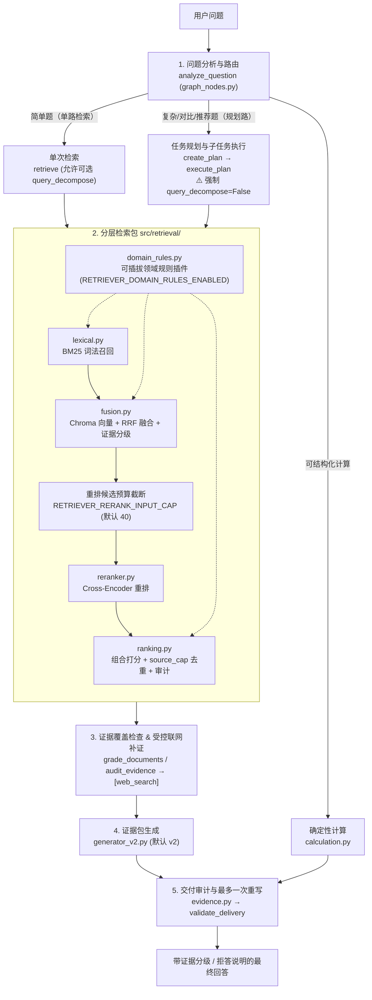

# RAG 目标精简架构（Route A 重构版）

> 本文档定义「设计知识库助手」瘦身后的 RAG 运行时目标架构、模块边界与核心不变量。
> 目标：**消除三层套娃、拆解 2434 行检索巨模块、隔离领域硬编码、给 CPU 重排加预算上限**，同时保持既有离线评测与测试契约完全兼容。

## 1. 瘦身前 vs 瘦身后

### 瘦身前的主要问题
1. **三层拆分套娃**：`create_plan / execute_plan`（拆子任务）→ `local_retrieval / retrieve_documents_multi`（LLM 再拆子查询）→ `retrieve_documents`（规则扩展 + 多路 BM25），再叠加全局串行锁 `_RETRIEVAL_EXECUTION_LOCK`，冷检索极易撞上 200~300 秒上限。
2. **检索巨模块（God Module）**：`src/retriever.py`（2434 行）把词法索引、向量召回、水杯/材料硬编码规则、Cross-Encoder 排序、多样性去重、诊断埋点与进程缓存全揉在一个文件里。
3. **重排输入无上限**：无 GPU 时 `bge-reranker` 落到 CPU，却直接对最多 `RETRIEVER_UNION_MAX_CANDIDATES=200` 条候选逐条推理，吃掉 70%–85% 的冷检索时间。
4. **编排层耦合领域细节**：`graph_nodes.py` 直接内嵌水杯内径/液高的正则判断。

### 瘦身后的目标架构

## 2. 核心不变量（Architecture Invariants）

1. **单层拆分不变量（No Double Decomposition）**
   - 当问题进入 `create_plan → execute_plan` 多子任务规划路径时，每个子任务调用 `local_retrieval` **强制 `query_decompose_enabled=False`**。
   - LLM 查询分解（`decompose_question`）只在单路 `retrieve` 且用户显式开启时生效，永不与任务规划叠加。
2. **重排输入预算不变量（Bounded Rerank Input）**
   - 无论 RRF 并集多宽（`RETRIEVER_UNION_MAX_CANDIDATES=200` 用于保留诊断和实体池），送入 Cross-Encoder 推理的候选数必须受 `RETRIEVER_RERANK_INPUT_CAP`（默认 `40`）硬限制，且通过 `_limit_union_candidates` 保留显式实体代表。
3. **领域规则可插拔不变量（Isolated Domain Heuristics）**
   - 所有特定语料/历史评测集的实体词典、标准号映射、水杯/材料先验集中收口到 `src/retrieval/domain_rules.py`。
   - 设置 `RETRIEVER_DOMAIN_RULES_ENABLED=false` 即可一键退化为**纯领域无关的通用混合检索**，方便接入钣金、CNC、注塑、压铸等新工艺语料。
4. **编排层领域无关不变量**
   - `graph_nodes.py` 不直接包含具体产品（如水杯内径/液高）的正则表达式，计算题识别由 `src/calculation.py` 统一封装。

## 3. 分层模块职责（`src/retrieval/`）

| 模块 | 职责 | 依赖方向 |
| --- | --- | --- |
| `src/retrieval/_compat.py` | 公共文档键、克隆、兼容门面配置解析 | 无内部依赖 |
| `src/retrieval/domain_rules.py` | 可插拔领域实体提取、BM25 实体通道、角色先验、低权威目录过滤 | `_compat`, `query_expansion` |
| `src/retrieval/fusion.py` | Chroma 稠密召回、RRF 融合、union 标注与截断、证据状态分级、置信度 | `_compat`, `domain_rules`, `document_metadata` |
| `src/retrieval/lexical.py` | BM25 分词、Chroma 文本缓存索引、单路/多路词法召回 | `_compat`, `domain_rules`, `fusion` |
| `src/retrieval/ranking.py` | 组合打分、Cross-Encoder 后处理筛选、`source_cap` 多样性去重、实体诊断 | `_compat`, `domain_rules` |
| `src/retrieval/pipeline.py` | `retrieve_documents`（缓存+串行锁+重排预算）、`retrieve_documents_multi` | 上述全部 + `reranker`, `embeddings` |
| `src/retriever.py` | **薄兼容门面**（re-export 公共 API 与历史符号），零业务逻辑 | `src/retrieval/*` |

## 4. 后续演进建议（基于瘦身后架构）

- **新工艺语料召回优化**：在 `RETRIEVER_DOMAIN_RULES_ENABLED=false` 基线上测纯通用检索，再按需为跨语种工艺指南新增轻量双语术语表或表格切分策略，不再污染核心检索管线。
- **消除 CPU 重排瓶颈**：若本机装上 CUDA PyTorch（`.\scripts\Install-CudaTorch.ps1`），重排可进一步降到秒级；无 GPU 时通过 `RETRIEVER_RERANK_INPUT_CAP`（如 `25`–`40`）控制延迟在可接受区间。
- **下一步无缝衔接产品闭环**：架构清爽后，可直接推进 [prd-feedback-loop.md](prd-feedback-loop.md) 的反馈入口与耗时/成本打点。
